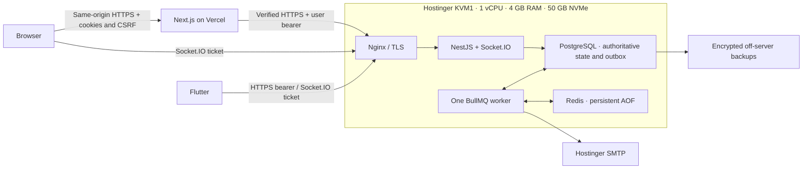

# Strength Studio architecture review

Status: Milestone 0 proposal for studio review. Source baseline: *Project Report – STRENGTH STUDIO*, §§4–18, *Strength Studio Infrastructure & Deployment Blueprint*, §§2–23, and the ERD, lifecycle, and deployment diagrams reviewed in this conversation. Where a source labels a workflow as proposed, its business policy remains open.

## Verdict

Retain the proposed modular NestJS backend, PostgreSQL and Prisma, Redis and BullMQ, Socket.IO, Flutter, Next.js on Vercel, and Hostinger KVM1. The inspected workspace was empty and Git was not initialized. There was no existing implementation or convention to migrate. Milestone 0 adds documentation only.

**Confirmed scope.** Single studio, two client onboarding routes, versioned time/session packages, manual finance and installments, authorized membership activation, booking approval, group sessions, coach attendance and Admin verification, refunds, credits, audit, and in-app/email delivery. Commission information and manual distributions are Admin-only. Branches, online payments, and automatic commission calculations are deferred. FCM is optional and disabled.

## Findings and proposed resolutions

| Priority | Finding | Smallest reliable resolution |
|---|---|---|
| Critical | A verified receipt alone does not prove funding for the membership being activated. | Require verified funding applied to the same purchase under the finance lock, subject to the approved threshold. Store the evidence on activation. A documented Admin exception is a separate path that staff cannot invoke. |
| Critical | Checking a refund cap at posting is too late for a manual cash return. | Reserve the amount and receipt capacity before execution. Allow one execution claim. Keep ambiguous payouts reserved for reconciliation. |
| Critical | Payment-to-installment is many-to-many, and one receipt can still contain unapplied funds. | Use typed finance events as allocation records, with scoped lot, purchase, and optional installment references. Preserve the source receipt and reverse using linked events. No separate accounting ledger is needed. |
| Critical | Booking, capacity, and coach rules can diverge across writers. | Use the same slot/client lock protocol for API, Admin, staff, and cleanup commands. Exclude coach range overlap in PostgreSQL. Move a booking and decide its change request atomically. |
| Critical | A returned attendance correction or coach reassignment could change historical attribution or balance. | Preserve the served reservation, immutable revisions, and accepted charged units. Keep the last accepted result effective until another is accepted. Apply the correction delta once. |
| Critical | UI hiding cannot protect commissions. | Separate database grants and private audit, gate the service before using its connection, and explicitly exclude commissions from generic output and delivery channels. |
| Important | Published terms, grace, suspension, and hold expiry could drift when configuration changes. | Freeze package versions and purchase snapshots. Version policy, record applied deadlines, and keep formal validity separate from authorized grace. |
| Important | Hostnames, workload, SMTP, and recoverability are unverified. | Verify real DNS and TLS, run a KVM1 load test, test provider delivery, and time an isolated restore. |
| Later | Waitlist ranking, mobile push, and accounting integration add scope. | Keep waitlist and push disabled until approved. Operational finance events provide traceability without introducing ERP accounting. |

## Deployment and security

Use the proposed `dashboard.<approved-domain>` and `api.<approved-domain>` hostname patterns. The actual DNS provider, addresses, domain, Ubuntu installation, and credentials have not been verified. Nginx publishes 80/443, proxies Socket.IO upgrades, and automates certificate renewal. Publish no database, Redis, or API container ports. Restrict SSH to approved keys and networks where practical. Verify firewall exposure externally. Build pinned images off-host and apply reviewed migrations once with a separate migration role.

See [API contract](api-contract.md) for the browser, Flutter, and socket credential flows. Keep previews isolated. NestJS checks the current user, session, action, and resource on every protected request. The dashboard has no PostgreSQL or Redis credentials. See [commission isolation](permission-matrix.md#commission-isolation) for private DB access, exports, cache controls, and prohibited delivery paths.

| Service | Proposed memory cap | Initial settings |
|---|---:|---|
| Nginx | 64 MiB | Request limits, TLS, WebSocket proxy |
| API | 512 MiB | One process, 288 MiB old-space starting ceiling, four ordinary PostgreSQL connections and one private commission connection, bounded password hashing |
| Worker | 384 MiB | One process, 192 MiB old-space starting ceiling, two PostgreSQL connections, concurrency one |
| PostgreSQL | 1,024 MiB | shared_buffers 192 MiB, work_mem 2 MiB, maintenance_work_mem 32 MiB, autovacuum_work_mem 16 MiB, max_connections 24, parallel query workers off |
| Redis | 320 MiB | maxmemory 96 MiB, noeviction, bounded queue retention, AOF every second |

Caps total 2,304 MiB. Reserve roughly 1 GiB for the host and verify actual usable memory. Old-space excludes native allocations. PostgreSQL work memory applies per query operation. Keep database durability and autovacuum enabled. Reserve 10–15 GB of disk for WAL, AOF rewrites, temporary work, and rollback images. These are starting values, not measured capacity.

PostgreSQL commits domain state, audit, inbox, and outbox together. The worker uses stable job IDs, database leases, lease-token fencing, bounded backoff, and durable attempts. Redis AOF helps routine restart continuity. Reconcile due intents and expired leases to rebuild work after Redis loss. SMTP outages delay email without rolling back business state. Ambiguous acknowledgments can duplicate an email. PostgreSQL outage fails protected operations closed and pauses leased dispatch. Socket outages fall back to REST. Hold expiry remains enforceable by database time when the worker is down.

For invitation, verification, and reset emails, store the challenge digest in PostgreSQL. Encrypt any temporary delivery copy of the secret in the outbox with a key kept outside the database. Queue jobs carry only the outbox ID. Clear the delivery copy on completion or expiry and keep it out of logs.

Use lightweight process liveness, PostgreSQL-backed readiness, and external TLS/HTTPS checks. Monitor CPU, memory, swap, disk and WAL, DB waits, worker progress, oldest outbox intent, failed deliveries, certificate expiry, and backup freshness. Load-test representative logins, reports, last-seat races, sockets, and email with an external generator. Include a backup, Redis rewrite, and worker restart. Gate release on agreed latency and recovery targets, no OOM or sustained swap pressure, and preserved business invariants.

Propose encrypted daily off-server PostgreSQL backups with 14 daily and four weekly copies. Hostinger daily backup is not assumed enabled. Verify checksums and freshness. Restore into a clean isolated database, recreate grants and extensions, verify constraints and migrations, reconcile finance and entitlement, and smoke-test with delivery disabled. Rebuild due jobs with empty Redis and time recovery against approved RPO/RTO. On an actual restore, reconcile manual receipts and payouts made after the snapshot before reopening finance. Test application rollback separately from database recovery.

Technical references: [PostgreSQL resource settings](https://www.postgresql.org/docs/current/runtime-config-resource.html), [Redis persistence](https://redis.io/docs/latest/operate/oss_and_stack/management/persistence/), [BullMQ production guidance](https://docs.bullmq.io/guide/going-to-production), [PostgreSQL logical backups](https://www.postgresql.org/docs/16/app-pgdump.html).

See [domain model](domain-model.md), [roadmap](implementation-roadmap.md), and [open decisions](open-decisions.md).
