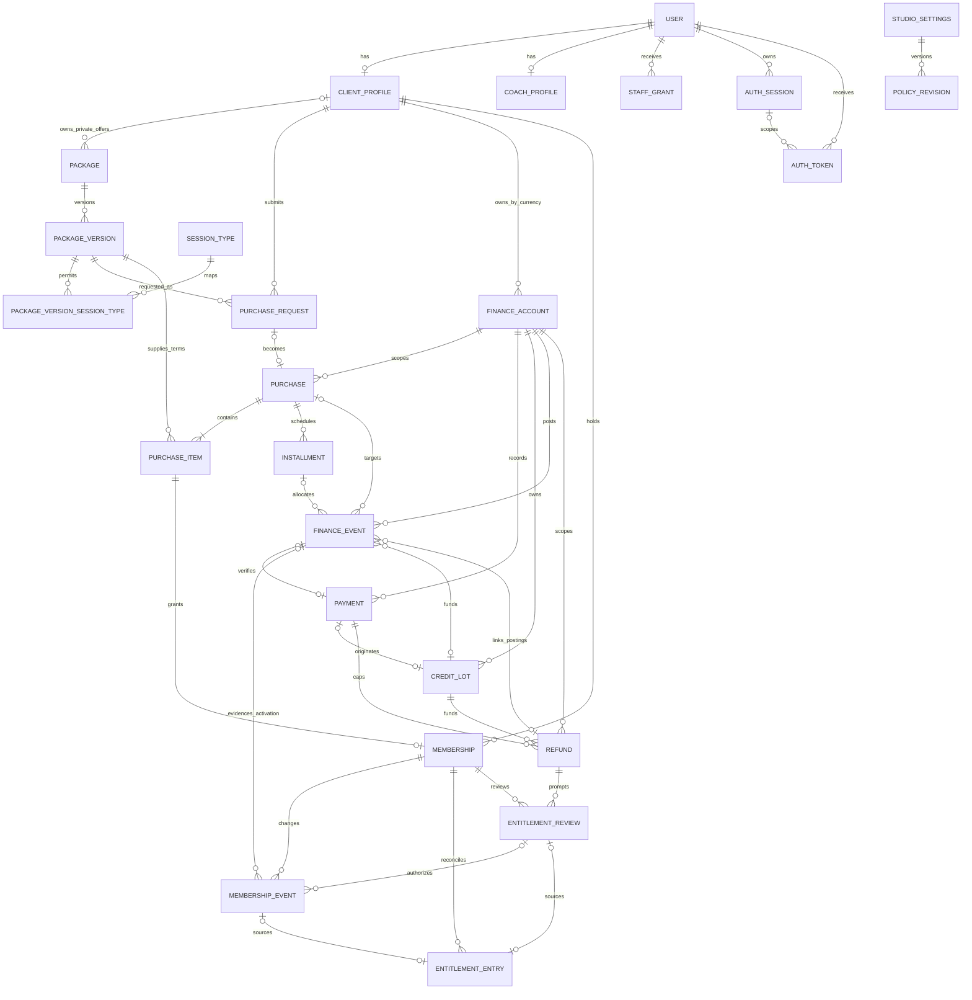
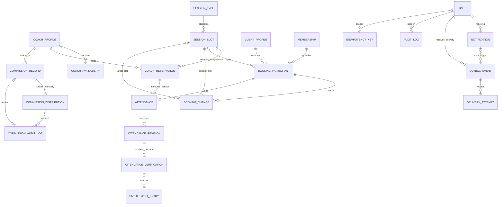

# Domain model and revised ERD

Status: proposed Milestone 0 schema. The two panels form one model. The [data dictionary](data-dictionary.md) defines all foreign keys, including actor, policy, scoped, and self-referencing edges omitted from the panels for readability. One studio is assumed. Branches are out of scope.

## Commercial and entitlement

## Service delivery, privacy, and operations

## Relationship corrections

- **Payment allocation is a relationship, not a second ledger.** Read PAYMENT → CREDIT_LOT → allocation FINANCE_EVENT → PURCHASE and optional INSTALLMENT. The event is the allocation row. Many lots can fund one installment and one lot can fund many installments. Reversal events reference prior allocation events. REFUND references the original payment and lot, and its linked events record any funding reversals and cash return. A refund can have zero or more entitlement reviews, each scoped to one membership.
- **Activation evidence belongs to the purchase.** MEMBERSHIP comes from one PURCHASE_ITEM. An activation MEMBERSHIP_EVENT cites a relevant allocation event backed by a verified payment and the policy used, or records a reasoned Admin exception. The transaction validates the full funding threshold across relevant allocations. One cited event is an evidence anchor, not the total.
- **Entitlement has multiple authorized sources.** An initial grant or administrative adjustment comes from a membership event, a refund effect from an entitlement review, and a verified usage adjustment from an accepted attendance verification. Each entry has exactly one source. ATTENDANCE_VERIFICATION is not a child of MEMBERSHIP_EVENT. They meet through the participant and entitlement entry.
- **One participant is one seat.** BOOKING_PARTICIPANT is the public booking ID. A group slot has many participant bookings, one per client per active slot. Slotless alternative requests do not reserve a seat. Group attendance is per participant.
- **Current projections and history differ.** Booking and membership hold current state. Booking changes, membership events, served coach assignments, attendance revisions, verification decisions, finance events, and entitlement entries preserve history. Account and unit balances are computed, never overwritten. The [scoped FK and ownership map](data-dictionary.md#scoped-foreign-keys-and-ownership) binds these records to the same client, purchase, or service assignment where required.
- **Versioned offers preserve agreed terms.** Public or client-only packages have immutable published versions and session eligibility. The purchase item snapshots agreed terms. Renegotiation creates a new version or a new explicit offer. It never silently substitutes price or validity on an existing request or purchase.
- **Private commission audit is a distinct access surface.** Commission records, distributions, and their audit use a restricted schema. Staff profiles do not need a separate table. Waitlist can use the participant model if enabled. A general ledger, branch entity, and push device registration are outside the initial build.

See [business rules](business-rules.md) for states and locks, and [permissions](permission-matrix.md) for access boundaries.
